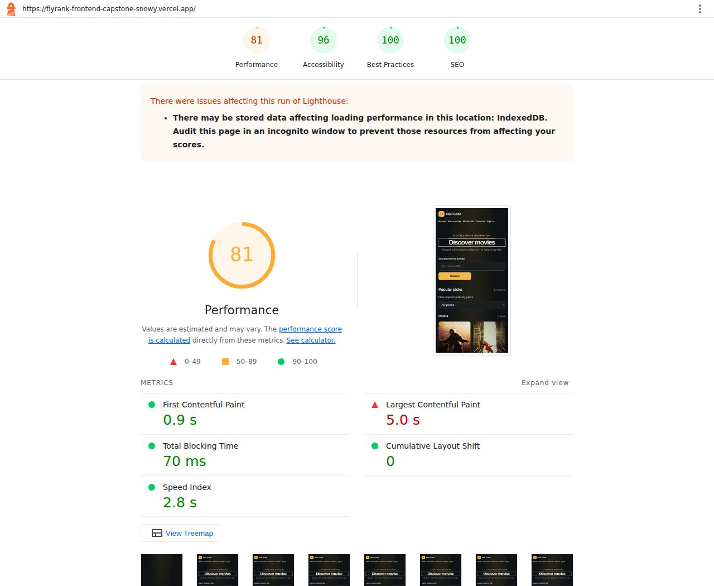
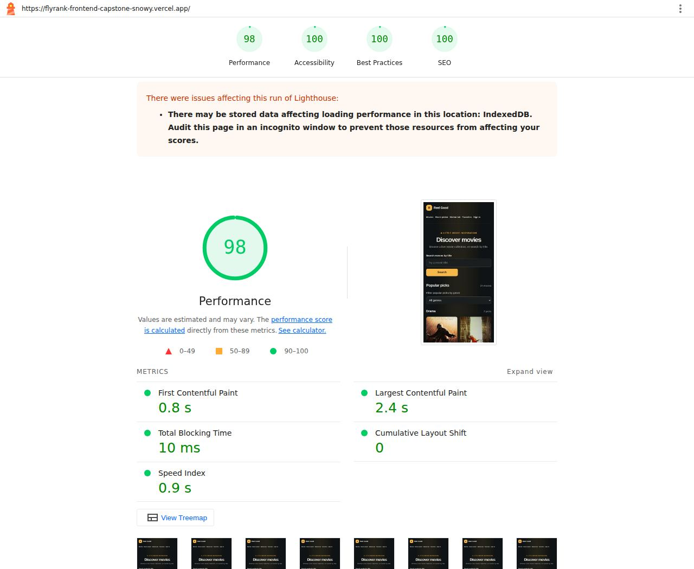
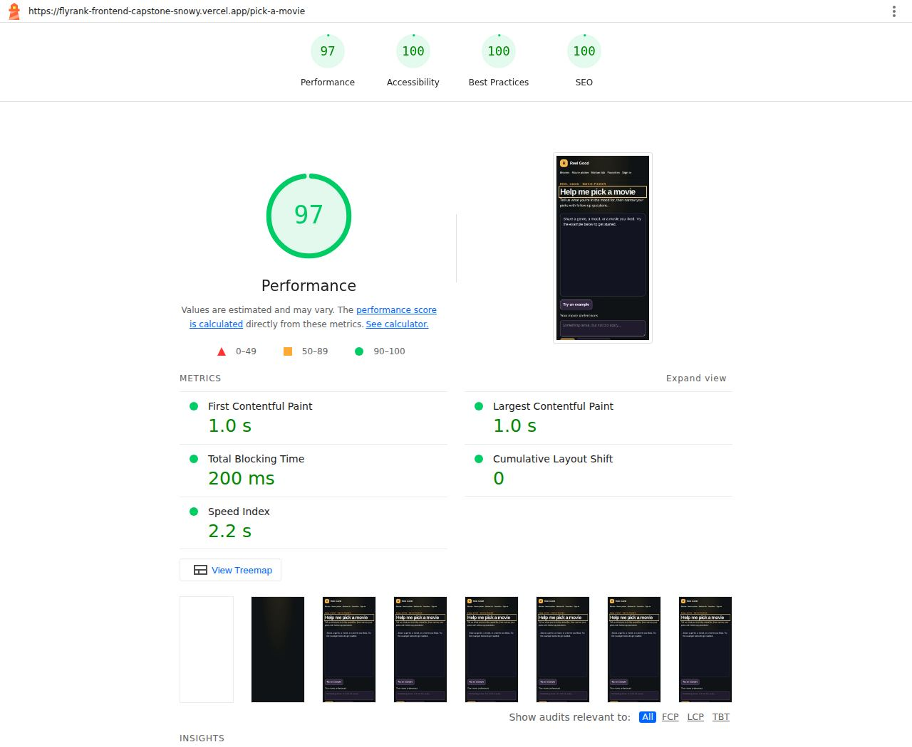
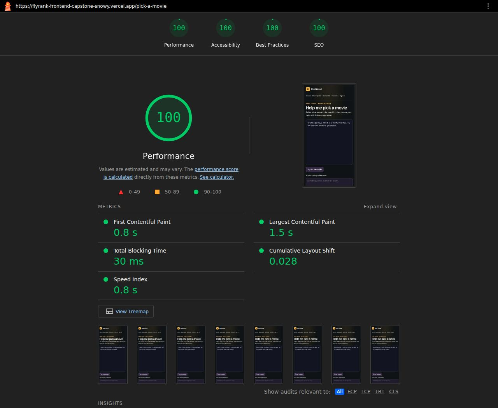

# Assignment 12 — Performance and accessibility audit

**A12 COMPLETE — AWAITING SUBMISSION**

Audited on **20 November 2026**. The deployed Home page improved from **81 to 98 performance** and **96 to 100 accessibility** on Lighthouse mobile. The movie picker improved from **97 to 100 performance**, retaining **100 accessibility**. Official WAVE checks report **zero errors, zero contrast errors and zero alerts** on all four audited public pages. The catalogue and chat keyboard journeys pass.

Public site: [Reel Good](https://flyrank-frontend-capstone-snowy.vercel.app/) · [Movie picker](https://flyrank-frontend-capstone-snowy.vercel.app/pick-a-movie).

## Deployed before and after

| Page | Performance before → after | Delta | Accessibility before → after | Delta |
| --- | ---: | ---: | ---: | ---: |
| Home, populated with 24 movies | 81 → **98** | **+17** | 96 → **100** | **+4** |
| Movie picker, initial conversation | 97 → **100** | **+3** | 100 → **100** | 0 |

Both final pages also scored **100 best practices / 100 SEO**.

| Metric | Home before → after | Movie picker before → after |
| --- | ---: | ---: |
| Largest Contentful Paint | 5.01 s → **2.36 s** | 1.01 s → **1.49 s** |
| Total Blocking Time | 69 ms → **6 ms** | 198 ms → **26 ms** |
| Cumulative Layout Shift | 0 → **0** | 0 → **0.028** |
| Total transfer | 757,972 B → **523,938 B** | 317,750 B → **130,730 B** |
| Transfer reduction | **30.9%** | **58.9%** |

Home LCP fell by **52.9%**. Chat's additional lazy-route loading increased LCP by about 0.48 s; its final LCP and CLS remain within the [good thresholds of 2.5 s and 0.1](https://web.dev/articles/vitals). These are laboratory navigation measurements, not field INP measurements.

### Actual Lighthouse screenshots

| Page | Before | After |
| --- | --- | --- |
| Home |  |  |
| Movie picker |  |  |

Machine-readable reports: [Home before](docs/assignment-12/evidence/live-before/home-mobile.json) · [Home after](docs/assignment-12/evidence/live-after/home-mobile.json) · [chat before](docs/assignment-12/evidence/live-before/chat-mobile.json) · [chat after](docs/assignment-12/evidence/live-after/chat-mobile.json).

## Findings, fixes and verification

| Finding | Implemented change | Verified result |
| --- | --- | --- |
| All routes downloaded account, chat, Motion and Firebase dependencies. | Split routes with React lazy/Suspense; load account and favorites services through guarded async imports with subscription cleanup. | Initial transfer reductions above; component and routing tests pass. |
| Configured Firebase still downloaded unused popup/redirect scripts and database code during browsing. | Use `initializeAuth` with the existing indexedDB/localStorage/sessionStorage persistence fallbacks; omit unused popup/redirect dependencies. Load database code through the signed-in favorites service. | Live configured sign-in form remains visible; **zero popup/redirect requests**; final Home and chat performance exceed 90. |
| Home waited for eight sequential batches of movie metadata before showing its posters. | Bound batches to six requests, halving the metadata round trips without increasing the total number of requests. | Populated live Home contains 24 cards; final LCP 2.36 s. |
| First visible posters were lazy-loaded; image geometry was implicit. | Eager-load and prioritize the first two visible posters, keep other posters lazy, add intrinsic dimensions and async decoding, and preconnect to the poster host. | Home CLS remains 0; live Lighthouse confirms eager/high-priority first-row images. Provider JPEG delivery remains an optimization opportunity. |
| IMDb links were only about 20 px high beside other controls. | Give IMDb and navigation links 44 px minimum target heights. | Deployed Home accessibility **96 → 100**; WAVE has no errors or alerts. |
| No skip navigation; lazy route navigation could lose heading focus. | Add a visible-on-focus skip link to focusable main, current-page navigation semantics and persistent route focus management outside the keyed error boundary. | First Tab/Enter reaches main; keyboard search → detail → back → chat passes, including destination heading focus. |
| WAVE flagged opacity-zero Motion button faces, weak decorative separators and a tiny decorative bullet. | Apply visibility to inactive faces after opacity transitions, raise separator contrast and replace the bullet with a CSS dot. Preserve reduced-motion behavior. | Motion contrast errors **13 → 0**; alerts **1 → 0**. |
| Stream status announced preparation without speaking the reply. | Send completed reply sentences to a polite, atomic live region in bounded batches; flush final text and announce lookup results. Keep the visible transcript separate. | Streaming component test, HTTP streaming fixture and live accessibility-tree observations confirm actual reply/result announcements. |
| Stop and recovery must work without a pointer. | Keep the labelled native Stop button, visible focus, abort handling, retry and input focus return. | Fixture cancellation mid-response and retry pass; live keyboard cancellation during preparation and next-turn lookup pass. |
| Earlier document metadata described another application. | Set Reel Good title, description and theme metadata; preserve route-specific titles. | Production build and route-title tests pass. |

Firebase initialization follows the [official dependency customization guidance](https://firebase.google.com/docs/auth/web/custom-dependencies). No account providers, permissions or persistence fallbacks were added.

## Official WAVE evaluation

The official Chrome extension evaluated these **rendered deployed states** after release:

| Page/state | Errors | Contrast errors | Alerts | Screenshot |
| --- | ---: | ---: | ---: | --- |
| Home, 24 populated movie cards | **0** | **0** | **0** | [Home](docs/assignment-12/evidence/live-after/wave/home.jpg) |
| Movie picker, empty conversation | **0** | **0** | **0** | [Chat](docs/assignment-12/evidence/live-after/wave/chat.jpg) |
| Motion lab, idle | **0** | **0** | **0** | [Motion](docs/assignment-12/evidence/live-after/wave/motion.jpg) |
| Account, configured signed-out email/password form | **0** | **0** | **0** | [Account](docs/assignment-12/evidence/live-after/wave/account.jpg) |

No alerts remain in these states. [Deployed WAVE data](docs/assignment-12/evidence/live-after/wave/summary.json).

The original comparable local pass found **13 contrast errors and one alert on Motion**, with zero errors elsewhere. [Before Motion screenshot](docs/assignment-12/evidence/local-before/wave/motion.jpg) · [after Motion screenshot](docs/assignment-12/evidence/local-after/wave/motion.jpg) · [local before data](docs/assignment-12/evidence/local-before/wave/summary.json) · [local after data](docs/assignment-12/evidence/local-after/wave/summary.json). Local Home and Account used handled unconfigured states; the deployed pass above covers populated Home and the active sign-in form.

## Keyboard and AI-specific verification

**Catalogue production bundle with deterministic movie HTTP fixtures:** Tab/Enter operated skip navigation, labelled search, search submission, a movie result, its detail page, the back-to-results link and the Movie picker navigation. Loaded destination headings received focus, the search query survived return navigation, and the example action focused the chat input. Search results fit both 320 and 375 CSS px. No console or page errors were observed. [Checks](docs/assignment-12/evidence/live-after/catalog-fixture/checks.json) · [focused result screenshot](docs/assignment-12/evidence/live-after/catalog-fixture/search-result-focused.jpg).

**Chat production bundle with a deterministic HTTP stream:** all interactions used keyboard input. The test confirmed a reply sentence reached `aria-live="polite"`, `aria-atomic="true"` before completion; Tab reached a visibly focused Stop; Space preserved the partial reply and returned focus to the textarea. A subsequent turn rendered a typed result card. An interrupted stream exposed an alert and Enter-activated retry. The conversation, cards and controls fit 320/375 px, with no console or page errors. No AI-provider requests were made by automated tests. [Checks](docs/assignment-12/evidence/keyboard/checks.json) · [skip link](docs/assignment-12/evidence/keyboard/skip-link.jpg) · [focused Stop](docs/assignment-12/evidence/keyboard/stop-focused.jpg) · [recovered result](docs/assignment-12/evidence/keyboard/recovered-tool.jpg).

**Manual keyboard pass on the real deployed chat:** Tab/Enter reached the skip link, example, labelled input and Send. An unfinished reply and updates to its polite live region were observed during streaming. On a second turn, Tab/Space stopped generation during preparation, announced the stop and returned focus to the input. A third keyboard-submitted turn produced the real Arrival (2016) lookup card with 7.9/10, 116 min and an IMDb link. The live region announced the lookup result. [Manual live observations](docs/assignment-12/evidence/keyboard/live-checks.json).

The final deployed smoke check also confirmed skip-link focus, no 375 px chat overflow, 24 live Home cards, the configured sign-in form and zero unused Firebase popup requests. [Live checks](docs/assignment-12/evidence/live-after/live-dom-checks.json) · [Home phone capture](docs/assignment-12/evidence/live-after/live-home-phone.jpg) · [chat phone capture](docs/assignment-12/evidence/live-after/live-chat-phone.jpg).

## Scope, method and provenance

- Definition-of-done review: [A11Y Project checklist review](docs/assignment-12/CHECKLIST.md).
- Baseline source: `d03e1ec9d7f755e474ef5e084a3da10765666728`, the A14 release containing the A10 tests and server rate limiting.
- Original baseline/local evidence: [workflow 44721157406](https://github.com/NiknaxTheGreek/flyrank-frontend-capstone/actions/runs/44721157406), captured before publication.
- Final deployed application: **`bfdd95eb274f6342a9f86c9023d1dcb24d425131`**, Vercel production deployment `dpl_Fv6qeMkpno8pDqdgr2eb4q3dixo6`. Publication was authorized on 20 November 2026.
- Final evidence: [successful workflow 44773847462](https://github.com/NiknaxTheGreek/flyrank-frontend-capstone/actions/runs/44773847462), audit helper commit `53d6c70d46d42b6233ddb31c79f5a4522fa80799`. [Provenance](docs/assignment-12/evidence/live-after/provenance.json).
- Lighthouse **13.6.0**, Chromium **158.0.8127.18**, default **mobile** preset: 412 × 823 CSS px, DPR 1.75, simulated mobile throttling. Browser cache was cleared for each audit. Exact settings, timestamps and numeric audits remain in JSON.
- One navigation per route per attempt. Scores vary with CPU and network conditions. The final Home report retains Lighthouse's IndexedDB stored-data warning; Firebase initializes that store. HTTP cache clearing and Lighthouse's default storage reset remained enabled. The baseline Home report showed the same warning.
- Screenshots show the original Lighthouse/WAVE reports; their scores were not redrawn. Embedded screenshot bytes were omitted from JSON to keep evidence smaller; numeric audits were preserved. Export archives and committed blobs were hash-verified.
- Physical mobile Safari, browser zoom at 200%/400%, forced colors and NVDA/VoiceOver listening were not tested. Live-region observations confirm DOM/AX updates rather than actual speech. Signed-in Favorites and account creation were not manually audited with credentials.
- WAVE evaluated the static page states listed above. Streaming/result/error behavior was covered by keyboard, component and manual chat checks rather than a WAVE scan of every conversation state. No WCAG conformance certification is claimed.

### Retained intermediate attempts

| Attempt | Home performance / accessibility | Evidence |
| --- | ---: | --- |
| Initial deployed A12 | 83 / 100 | [Report screenshot](docs/assignment-12/evidence/live-first-pass/home-mobile.jpg) · [data](docs/assignment-12/evidence/live-first-pass/home-mobile.json) |
| Six-request batches, before SDK trimming | 80 / 100 | [Report screenshot](docs/assignment-12/evidence/live-second-pass/home-mobile.jpg) · [data](docs/assignment-12/evidence/live-second-pass/home-mobile.json) |
| SDK trimmed; catalogue assertion ran before focus settled | 95 / 100 | [Recorded metrics and export limitation](docs/assignment-12/evidence/live-third-pass/metrics.json) |
| Complete final run, same deployed application | **98 / 100** | Final screenshots and reports above |

The catalogue assertion now uses a retrying focus check for React's effect to settle. It passes without another application change. Intermediate outcomes are retained to make the performance changes and run-to-run variation traceable.

### Earlier comparable local benchmarks

| Local page/state | Performance before → after | Accessibility before → after | Transfer before → after |
| --- | ---: | ---: | ---: |
| Home, unconfigured | 100 → 100 | 100 → 100 | 175,270 B → 65,538 B (**62.6% smaller**) |
| Movie picker, initial | 100 → 100 | 100 → 100 | 174,505 B → 95,735 B (**45.1% smaller**) |

These earlier route-splitting benchmarks used the same runner/browser, without OMDb/Firebase credentials. They describe the local states. The populated, configured deployed measurements at the top are the submission results. [Local Home before](docs/assignment-12/evidence/local-before/home-mobile.jpg) · [after](docs/assignment-12/evidence/local-after/home-mobile.jpg) · [local chat before](docs/assignment-12/evidence/local-before/chat-mobile.jpg) · [after](docs/assignment-12/evidence/local-after/chat-mobile.jpg).

## Regression checks and reproduction

TypeScript checks, all **91 component/server tests across 17 files**, and the production build passed after the final Firebase change. [Recorded local verification](docs/assignment-12/evidence/local-component-tests.txt). The final deployed audit workflow also passed the configured-app smoke checks and five catalogue keyboard checks. The cross-browser test no longer polls brief tool states delivered together by its buffered fixture: a frame-controlled component test verifies those states, while the browser journey verifies pending, completed result and contextual follow-up behavior. A fresh release verification is running for that test-only correction.

```bash
npm ci
npx playwright install --with-deps chromium
npm run typecheck
npm test
npm run build
```

Run `node scripts/audit-keyboard.mjs` for the local streaming fixture, and `node scripts/audit-catalog-keyboard.mjs` for the local catalogue fixture. Use `AUDIT_CHROME_PATH` when Chrome is installed outside Playwright's default path.

For a new deployed measurement, set `AUDIT_URL` to the deployment, `AUDIT_PHASE` to a descriptive name and `AUDIT_OUTPUT` to a new evidence directory; run `npm run audit:lighthouse`. Set `WAVE_EXTENSION` to an unpacked official Chrome extension before running `npm run audit:wave`. The `A12 deployed mobile and accessibility audit` workflow runs both against the public application and exports the report images and JSON. Use a new directory to preserve these dated before/after measurements.

No learner-portal submission was performed. The implementation, public deployment and audit evidence are ready for submission.
