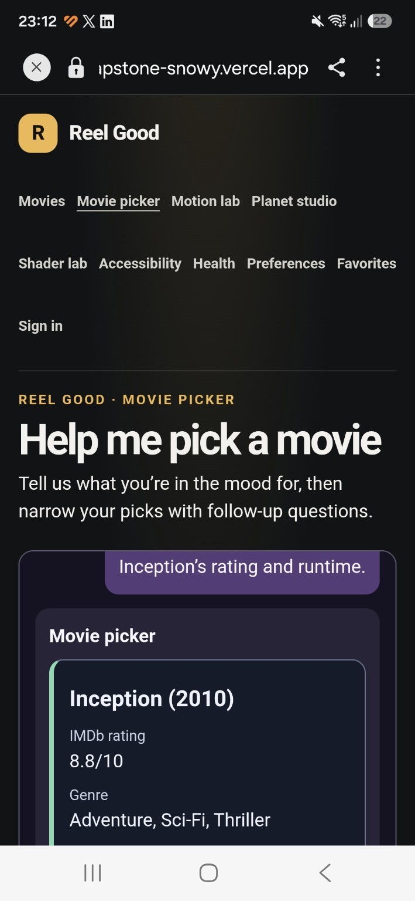
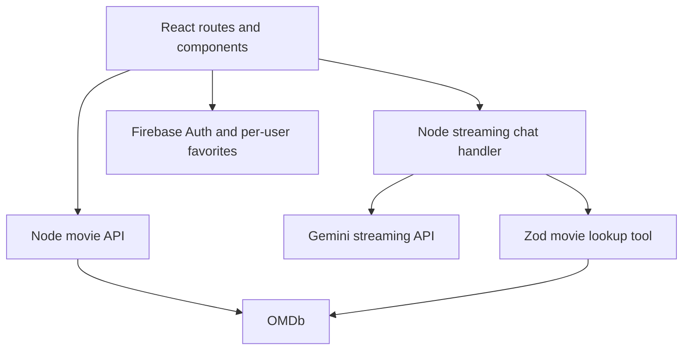

# Reel Good — Production release

In this assignment, the completed Reel Good application is deployed to production with integrated features, API safeguards and release documentation.

Reel Good is a responsive movie discovery app. Browse films, explore movie details, save favorites and receive streaming AI recommendations. Factual movie requests return structured cards with verified OMDb data.

**Production:** https://flyrank-frontend-capstone-snowy.vercel.app



## Clone and run

Requirements: Git, Node.js 24 LTS, npm and provider accounts for live features.

```sh
git clone --branch fe14-production-release https://github.com/NiknaxTheGreek/flyrank-frontend-capstone.git
cd flyrank-frontend-capstone
npm ci
cp .env.example .env.local
# Set the environment variables below.
npm run dev
```

Open http://localhost:5173. Restart after changing environment variables. Without credentials, live provider features display configuration errors. Tests require no credentials.

## Environment variables

| Variable | Purpose | Source |
| --- | --- | --- |
| `OMDB_API_KEY` | Movie catalogue, details and lookup | OMDb server secret |
| `GEMINI_API_KEY` | Streaming recommendations | Google AI Studio server secret |
| `GEMINI_MODEL` | Optional model override | Default: `gemini-3.5-flash-lite` |
| `VITE_FIREBASE_API_KEY` | Firebase web configuration | Firebase console |
| `VITE_FIREBASE_AUTH_DOMAIN` | Authentication domain | Firebase console |
| `VITE_FIREBASE_PROJECT_ID` | Project ID | Firebase console |
| `VITE_FIREBASE_APP_ID` | Web app ID | Firebase console |
| `VITE_FIREBASE_DATABASE_URL` | Realtime Database URL | Firebase console |

Keep provider secrets server-side. Never prefix them with `VITE_`. The ignored `.env.local` file holds local credentials.

Enable Email/Password Authentication in Firebase and create a Realtime Database. Copy the web configuration above and add the deployment hostname to the authorized domains.

Deploy the [database rules](database.rules.json) to your Firebase project:

```sh
npx firebase-tools login
npx firebase-tools use --add
npx firebase-tools deploy --only database
```

The rules validate movie records and restrict access to the authenticated user's UID.

## Explore the application

| Route | Feature |
| --- | --- |
| `/movies` | Browse, search and inspect film details |
| `/pick-a-movie` | Streaming recommendations, movie lookup, Stop and retry |
| `/account`, `/favorites` | Sign in and manage saved movies |
| `/preferences` | Validated notification settings |
| `/motion-lab` | Asynchronous button states and reduced motion |
| `/planet-studio` | Interactive Three.js world configurator |
| `/shader-lab` | Interactive GLSL hero |
| `/playground` | Accessible tabs, disclosure and dialog |
| `/health` | Server-side data-fetch status |

Explore any film or preference. Sign in to save and remove favorites. The application includes accessible feedback for loading, empty results and failures.

## Architecture



| Component | Responsibility |
| --- | --- |
| `src/pages`, `src/components` | UI, accessibility, route recovery and tool cards |
| `src/services/movie-chat-stream.ts` | SSE parsing |
| `api/movie-chat.mjs`, `server/movie-chat-handler.mjs` | Streaming, cancellation and validated requests |
| `server/movie-chat-config.mjs` | Model, instructions and output budget |
| `server/lookup-movie-tool.mjs` | Validated, read-only OMDb lookup |
| `api/movies.mjs` | Catalogue queries, caching and bounded concurrency |
| Firebase contexts | Authentication and isolated favorites |
| `vercel.json` | API duration limits and deep-link rewrites |

## Production safeguards

| Control | Limit |
| --- | --- |
| Chat request rate | 10/minute/client IP; 1,000/hour/warm instance |
| Request body | 192,000 bytes |
| Conversation | 1–20 messages; 8,000 characters each; 32,000 total |
| AI response | 700 output tokens; one movie lookup |
| Timeout | 40-second upstream deadline; 60-second function duration |
| OMDb | 60 upstream calls/minute/instance; three concurrent detail requests; 15-second timeout |

Chat accepts POST requests, rejects foreign browser origins and validates message roles. Stop and disconnect cancel upstream work. Blocked requests return HTTP 429 with `Retry-After`.

Rate counters reset on cold starts and are not shared between instances. Provider quota caps or a shared limiter are needed for an account-wide spending limit. Origin checks are not authentication.

## Testing

```sh
npm run typecheck
npm test
npm run build
npm run test:e2e:install
npm run test:e2e
npm run preview
```

Vitest, React Testing Library and Playwright cover component states, forms, accessibility, API validation and browser journeys. Automated regression tests mock provider calls; the separate live smoke test uses real services.

See the [release verification](docs/assignment-14/README.md) for results, evidence and device limitations.

## Technical decisions

- React/Vite preserves the existing movie application and supports lazy routes.
- Node handlers keep credentials off the client and run locally and on Vercel.
- Gemini SSE supports progressive replies, cancellation and recovery.
- Zod validates tool inputs. React renders structured results without injecting model-generated HTML.
- Firebase provides authentication and UID-scoped storage.
- Lazy GPU modules, bounded rendering and static fallbacks reduce initial load and support reduced motion.

## How AI tools were used

I used ChatGPT as a development tool for planning, code suggestions, debugging, test design and documentation. Specific applications included the OMDb proxy, SSE parsing, typed tool results, accessible feedback, rate limiting and deployment checks.

The [prompt record](docs/assignment-3/prompts.md), [AI assistance record](docs/assignment-3/ai-assistance.md) and [review log](docs/assignment-3/review-log.md) document earlier development work. The [testing record](docs/assignment-10/README.md) includes a regression failure and its correction.

Gemini powers the runtime movie assistant. ChatGPT is a development tool, not the application's runtime model.

## Deploy

Import the repository into Vercel using the Vite preset, Node 24, build command `npm run build` and output directory `dist`. Configure the Production environment variables, deploy the release branch and verify the public routes.

Use the [release verification](docs/assignment-14/README.md) and [integration record](docs/assignment-14/INTEGRATION.md) to inspect the deployed build. Roll back if a smoke test fails.

## Assignment integration

| Assignment | Contribution |
| --- | --- |
| A1–A2 | Project conventions, preferences form and workflow comparison |
| A3 | Movie catalogue, details, authentication and favorites |
| A4 | Routing and health screen; original Next.js scaffold retained separately |
| A5 | Accessibility playground |
| A6–A8 | Streaming chat, movie tool and recovery |
| A9 | Motion Lab |
| A10 | Automated tests and CI |
| A11 | Planet Studio |
| A12 | Accessibility and performance improvements |
| A13 | Shader Lab |

The dedicated assignment branches preserve the original work. The integrated product retains the corresponding features.
