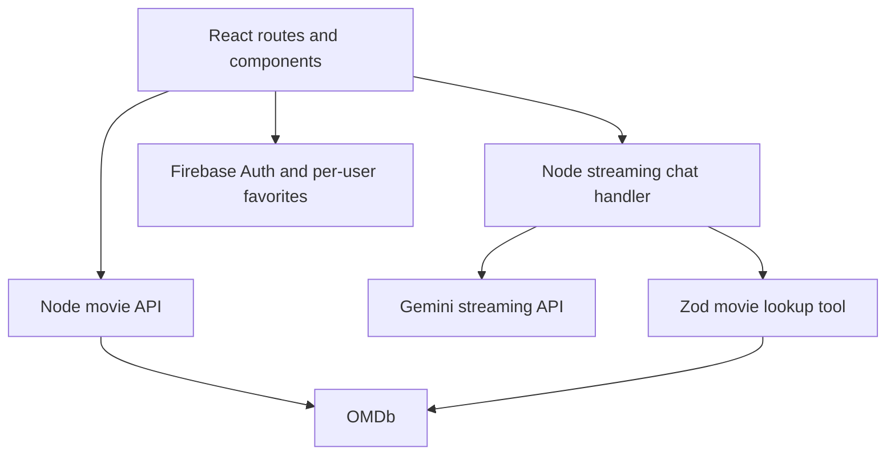

# Reel Good

A responsive movie discovery app: browse and search films, inspect OMDb details, save favorites with Firebase, and ask a streaming movie assistant for recommendations. When asked for facts about a named film, the assistant runs a validated server-side lookup and shows a movie card with an IMDb link.

**Production:** https://flyrank-frontend-capstone-snowy.vercel.app  
**Release source:** `fe14-production-release`  
**Checkpoint 2:** [release verification and remaining checks](docs/assignment-14/README.md)


## Clone and run

Requires Node.js 24 LTS, npm, Git, and provider accounts for live features. Repository access is required while this repository is private.

```sh
git clone --branch fe14-production-release https://github.com/NiknaxTheGreek/flyrank-frontend-capstone.git
cd flyrank-frontend-capstone
npm ci
cp .env.example .env.local
# Populate .env.local using the table below.
npm run dev
```

Open http://localhost:5173. Restart after changing environment variables. With no credentials, the UI and motion lab run, but live movie search, chat, and accounts show configuration errors. Automated tests need no credentials.

```sh
npm run typecheck
npm test
npm run build
npm run test:e2e:install
npm run test:e2e
npm run preview  # built app at http://localhost:4173
```

Vite development and preview mount the same API handlers used in Vercel. `vite preview` is for local verification; Vercel hosts the production API functions and static bundle.

## Environment variables

| Name | Required for | Visibility / source |
| --- | --- | --- |
| `OMDB_API_KEY` | Live browse, search, details and chat lookup | Server secret from OMDb; activate the key before use |
| `GEMINI_API_KEY` | Streaming movie assistant | Server secret from Google AI Studio |
| `GEMINI_MODEL` | Optional model override | Server configuration; default `gemini-3.5-flash-lite` |
| `VITE_FIREBASE_API_KEY` | Sign-in and saved favorites | Public Firebase web-app configuration |
| `VITE_FIREBASE_AUTH_DOMAIN` | Sign-in and saved favorites | Firebase Authentication domain |
| `VITE_FIREBASE_PROJECT_ID` | Sign-in and saved favorites | Firebase project ID |
| `VITE_FIREBASE_APP_ID` | Sign-in and saved favorites | Firebase web app ID |
| `VITE_FIREBASE_DATABASE_URL` | Sign-in and saved favorites | Firebase Realtime Database URL |

Never prefix provider secrets with `VITE_`: those values are bundled into browser code. `.env.local` is ignored. Firebase web configuration is public; database rules enforce access.

For Firebase, register a web app, enable Email/Password Authentication, create a Realtime Database, and copy its web configuration into the five variables. Add your deployed hostname to Authentication → Settings → Authorized domains. Deploy [database.rules.json](database.rules.json) to the same project:

```sh
npx firebase-tools login
npx firebase-tools use --add
npx firebase-tools deploy --only database
```

Rules restrict records to their authenticated UID and validate movie fields. A separate live REST smoke verified signup, owner-only favorite persistence and rejection of anonymous/other-user reads, then removed its temporary records and accounts. This does not replace an emulator suite or a real-device sign-in check.

## Main flow

1. Open `/movies`, search a title, and open its details.
2. Open `/pick-a-movie`, enter a mood, and choose Send. Stop generation cancels upstream work; retry recovers interrupted replies.
3. Ask “Show me Inception's IMDb rating and runtime.” The read-only lookup returns a structured card.
4. Sign in at `/account` and save a movie to `/favorites`.

Search query and pagination are URL-backed. Loading, no results, missing posters, provider failures and interrupted streams have visible recovery paths. `/motion-lab` demonstrates the reusable button lifecycle without API credentials. The completed Planet Studio (`/planet-studio`), Shader Lab (`/shader-lab`), accessibility playground (`/playground`) and health screen (`/health`) are now integrated into the same product and navigation. Original assignment branches remain preserved as provenance.

## Architecture



- `src/pages` and `src/components`: accessible UI, route recovery, chat renderer and tool cards.
- `src/services/movie-chat-stream.ts`: SSE parser; `MovieChat.tsx` manages cancellation, history, partial replies and retry.
- `api/movie-chat.mjs`: Node adapter for `server/movie-chat-handler.mjs`.
- `server/movie-chat-config.mjs`: model, recommendation instructions and output budget.
- `server/lookup-movie-tool.mjs`: validates `{ title: string }` (trimmed, 2–100 characters) and fetches OMDb. Output is `{ title, year, genre, runtime, rating, plot, imdbId }`; rating is numeric or null. UI states: input streaming, input available, output available, output error.
- `api/movies.mjs`: validates query/ID/page, caches results for five minutes, deduplicates detail requests and bounds concurrent lookups.
- Firebase contexts clear per-user state when authentication changes. Vercel rewrites preserve deep links while `/api/*` remains server-side.

## Production safeguards and tradeoffs

Chat accepts POST only, rejects foreign browser origins, reads at most 192,000 request bytes, accepts 1–20 user/assistant messages, caps each at 8,000 characters and total text at 32,000 characters. System-role messages are rejected. Each request permits one movie lookup, at most 700 model output tokens, and a 40-second upstream deadline. Vercel's streaming function has a 60-second `maxDuration` to allow cleanup. Stop/disconnect aborts upstream work.

The chat limiter permits 10 requests per minute per Vercel-supplied client IP and 1,000 per hour per warm instance, with HTTP 429 and `Retry-After`. Its map is bounded. **These counters reset on cold starts and are not shared between server instances.** They reduce simple repeated abuse but do not enforce an account-wide spending budget. Keep provider billing/quota caps configured; use a shared Redis limiter or Vercel Firewall rule for stronger multi-instance enforcement. Origin checks are a browser defense, not authentication.

OMDb has a separate per-instance 60-upstream-call/minute guard, three concurrent detail fetches, 15-second call timeouts and bounded caching. Unknown facts are omitted rather than invented. The model has no arbitrary URL, SQL, filesystem or write tool. No paid-provider fallback exists. Chat is not persisted across reloads. Provider availability and free-tier quotas can still stop live requests.

## Tests and release verification

Vitest and React Testing Library query controls by role and label. Tests cover chat pending/streaming/error states, all tool states, validated forms, routing, favorites behavior, button lifecycle, server validation, rate limiting and cancellation. Provider calls are mocked; tests never consume AI credits. Playwright walks the primary flow and interruption/retry on desktop/phone Chromium, Firefox, desktop WebKit and iPhone-sized WebKit. CI runs type checks, tests, build and Playwright on pushes and pull requests.

See [Assignment 10](docs/assignment-10/README.md) for the original failure/fix demonstration. A green workflow is distinct from a repository branch protection rule. See [Assignment 14](docs/assignment-14/README.md) for actual release results and browser limitations; Playwright WebKit is not proof of testing real Safari on an iPhone.

## Decisions

React/Vite preserves the working movie application rather than migrating it to a different framework for deployment. Small Node functions keep provider credentials off the client and reuse handler code locally. Direct Gemini SSE makes cancellation and partial failures explicit. Zod validates the one read-only movie tool; React renders text without injecting model-generated HTML. Firebase provides identity and UID-scoped persistence. CSS transform/opacity transitions and reduced-motion rules preserve feedback without requiring animation.

## How AI tools built this

ChatGPT assisted with the implementation and debugging throughout these assignments: the OMDb proxy and normalization, stale-response/cancellation handling, Gemini SSE parsing, structured tool events and card rendering, retry semantics, accessible state feedback, reusable animated button, Vitest/Playwright coverage, and release documentation. Assignment 3's [prompts](docs/assignment-3/prompts.md), [AI assistance record](docs/assignment-3/ai-assistance.md), and [review log](docs/assignment-3/review-log.md) retain concrete examples. Assignment 10 records a renderer failure and the subsequent verified fix.

For Assignment 14, ChatGPT inspected the deployed project and branch history, reused the tested A10 application, added the rate-limit/origin/input guards and regression tests, corrected the Node request URL used for origin checking, prepared this README, configured production environment targets without copying secret values into source, and ran the checks listed in the release report. The learner supplied requirements and prior browser evidence and must be able to explain and modify the implementation. AI-generated tests and prose do not substitute for real provider, Firebase authorization, or device checks. Runtime recommendations come from Gemini; ChatGPT is the development assistant. This project does not claim Claude Code was used.

## Deployment and history

Import this repository into Vercel as Vite; build `npm run build`, output `dist`, Node 24. Set the environment variables for **Production** and redeploy `fe14-production-release`. Confirm the commit and target before promoting. Completed A11/A12/A13 code and the A5 playground are integrated into the release; existing assignment branches are preserved; focused Conventional Commits record the release without rewriting shared history. Roll back to a known-good production deployment if a smoke check fails.

Code and documentation in Git have no scheduled expiry, but access still depends on repository visibility and hosting/account availability. This README's production address is a normal hostname, not a temporary share token.

## Integrated assignment release — 20 November 2026

The release now combines the completed work rather than shipping the A10 snapshot alone:

| Assignment | Product or repository location |
| --- | --- |
| A1–A2 | Setup/conventions, validated preferences form and retained comparison branches |
| A3 | Live movie browsing, details, Firebase sign-in and favorites |
| A4 | Deep-linkable routes and `/health` server-fetch screen; original Next.js scaffold retained on its assignment branch |
| A5 | `/playground`: custom disclosure/tabs/dialog and shadcn/Radix comparison, adapted to the final Vite host |
| A6–A8 | `/pick-a-movie`: streaming chat, movie lookup, cancellation, retry and resilience |
| A9 | `/motion-lab` |
| A10 | Component/server tests and multi-engine Playwright CI |
| A11 | `/planet-studio`: opt-in lazy-loaded Three.js world configurator |
| A12 | Lazy routes/Firebase modules, skip link, route focus, live announcements, contrast and image sizing fixes; historical [AUDIT.md](AUDIT.md) |
| A13 | `/shader-lab`: Afterlight GLSL hero, palette changes, pause, pointer interaction and static fallback |
| A14 | Production hosting, bounded APIs and this README |

The historical audit and screenshots record their original commits; they do not automatically certify the new combined build. [Integration verification](docs/assignment-14/INTEGRATION.md) records the new release checks. The earlier address-bar screenshot is retained as pre-integration evidence and will be replaced as the current submission screenshot.
