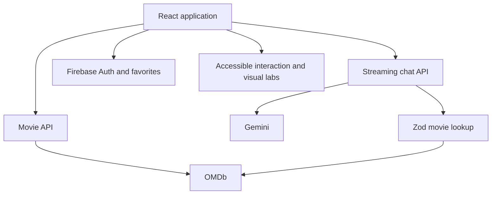

# Reel Good — Frontend Capstone

Reel Good is a responsive movie discovery application that combines live movie search, personal favorites and an AI-powered conversational movie assistant. The project was developed across 14 assignments in the FlyRank frontend programme, progressing from repository foundations to a fully integrated production release.

**[Explore the finished application](https://flyrank-frontend-capstone-snowy.vercel.app/)** · **[Movie picker](https://flyrank-frontend-capstone-snowy.vercel.app/pick-a-movie)** · **[Production source and setup](https://github.com/NiknaxTheGreek/flyrank-frontend-capstone/tree/fe14-production-release)** · **[Release verification](https://github.com/NiknaxTheGreek/flyrank-frontend-capstone/blob/fe14-production-release/docs/assignment-14/README.md)**


## The finished product

- Browse featured films and search live OMDb data; open detailed film information and IMDb links.
- Sign in through Firebase and maintain a personal favorites collection.
- Ask for recommendations in a streaming AI conversation. Stop or retry requests and continue with contextual follow-up questions.
- Retrieve factual movie details through a validated server-side tool, displayed as structured cards with distinct progress and error states.
- Explore Planet Studio, Afterlight Shader Lab, Motion Lab, the accessibility playground, Preferences and the service health screen.

The application uses React, TypeScript, Vite and React Router in production, with Node server handlers on Vercel, Gemini streaming, OMDb, Firebase Authentication and Realtime Database, and Zod validation.

## Repository architecture: 14 assignments

The default branch is the project guide. Each assignment has its own branch containing the relevant implementation, README and evidence. A2 has two branches for the prompting comparison. The integrated application is on A14; earlier assignments are preserved as development checkpoints, not separate products that must all be merged into main.

| Part | Assignment and source | Goal and contribution |
|---|---|---|
| A1 | [Project setup](https://github.com/NiknaxTheGreek/flyrank-frontend-capstone/tree/fe01-project-setup) | Establish reproducible tooling, Git conventions and project documentation. |
| A2 | [Prompt specification](https://github.com/NiknaxTheGreek/flyrank-frontend-capstone/tree/fe02-spec) · [first variant](https://github.com/NiknaxTheGreek/flyrank-frontend-capstone/tree/fe02-vague) | Compare vague and structured AI instructions through a validated settings feature. |
| A3 | [Movie discovery](https://github.com/NiknaxTheGreek/flyrank-frontend-capstone/tree/fe03-movie-app) | Build the core movie catalogue, live search, detail pages and authenticated favorites. |
| A4 | [Scaffold and deploy](https://github.com/NiknaxTheGreek/flyrank-frontend-capstone/tree/fe04-scaffold-deploy) | Establish routes, responsive layout, shared navigation and Git-connected previews. |
| A5 | [Accessibility playground](https://github.com/NiknaxTheGreek/flyrank-frontend-capstone/tree/fe05-accessibility-playground) | Understand keyboard and focus behavior through custom widgets and library comparisons. |
| A6 | [Streaming interface](https://github.com/NiknaxTheGreek/flyrank-frontend-capstone/tree/fe06-reel-good-movie-chat) | Add a conversational movie assistant with incremental responses, cancellation and context. |
| A7 | [Tool lifecycle UI](https://github.com/NiknaxTheGreek/flyrank-frontend-capstone/tree/fe07-movie-lookup-tool) | Connect chat to validated server-side movie lookup and structured result cards. |
| A8 | [Resilience checkpoint](https://github.com/NiknaxTheGreek/flyrank-frontend-capstone/tree/fe08-resilience-checkpoint) | Handle failures, interrupted streams, loading, empty states and retries. |
| A9 | [Button lifecycle](https://github.com/NiknaxTheGreek/flyrank-frontend-capstone/tree/fe09-button-lifecycle) | Develop reusable async controls with five states and accessible motion. |
| A10 | [Testing and CI](https://github.com/NiknaxTheGreek/flyrank-frontend-capstone/tree/fe10-tests-and-ci) | Protect core flows with component and browser tests and required merge checks. |
| A11 | [Planet Studio](https://github.com/NiknaxTheGreek/flyrank-frontend-capstone/tree/fe11-planet-studio) | Explore optional interactive 3D worlds with accessible static fallbacks. |
| A12 | [Performance and accessibility](https://github.com/NiknaxTheGreek/flyrank-frontend-capstone/tree/fe12-performance-accessibility) | Measure and improve loading performance, accessibility and keyboard navigation. |
| A13 | [Afterlight shader](https://github.com/NiknaxTheGreek/flyrank-frontend-capstone/tree/fe13-fragment-shader) | Create an interactive GPU-powered cinematic hero with reduced-motion support. |
| A14 | [Production release](https://github.com/NiknaxTheGreek/flyrank-frontend-capstone/tree/fe14-production-release) | Integrate the features, document architecture and safeguards, and deploy the final application. |

### How the parts connect

A1–A5 establish the environment, AI-assisted development workflow, core movie application, deployment scaffold and accessible interaction patterns. A6–A8 develop the primary AI experience, progressing from streaming text to structured tool results and resilient recovery. A9–A10 refine asynchronous controls and automate regression verification. A11–A13 extend the visual experience and improve application quality. A14 integrates the completed features into a single production application. The original Next.js scaffold and accessibility exercise remain on their assignment branches; the final integrated application uses React/Vite.

## Product architecture



In the [release branch](https://github.com/NiknaxTheGreek/flyrank-frontend-capstone/tree/fe14-production-release), `src/pages/` and `src/components/` implement the interface; `src/services/` manages data and typed stream parsing; `api/` and `server/` implement same-origin server endpoints and validated tools. Firebase rules enforce ownership of favorites. Tests and Playwright journeys accompany the implementation, with GitHub Actions providing continuous verification.

## Run and review

Clone the production branch for the integrated application:

```sh
git clone --branch fe14-production-release https://github.com/NiknaxTheGreek/flyrank-frontend-capstone.git
cd flyrank-frontend-capstone
npm ci
npm run dev
```

Use Node 24. Configure server-side OMDb and Gemini credentials and Firebase public web configuration according to the [release README](https://github.com/NiknaxTheGreek/flyrank-frontend-capstone/blob/fe14-production-release/README.md). Automated tests use mocked providers; no AI credits are required.

For the original assignment-specific requirements and evidence, open the corresponding branch in the table. For the combined product, see the [integration report](https://github.com/NiknaxTheGreek/flyrank-frontend-capstone/blob/fe14-production-release/docs/assignment-14/INTEGRATION.md).

## Verification and scope

The recorded combined release passed 100 component/server tests and 24 browser journeys, with six GPU-specific cases skipped outside Chromium and static fallbacks tested there. Public production was recorded READY. Physical Apple Safari/device testing remains unverified; browser emulation is not a substitute. The release documentation records provider quotas, per-instance rate-limiting scope, and other implementation limitations.

Repository-wide historical credential remediation remains outstanding. Keep provider secrets server-side and never commit them. ChatGPT assisted with development; Gemini is the runtime recommendation provider. Assignment documentation records the relevant implementation and review evidence.
