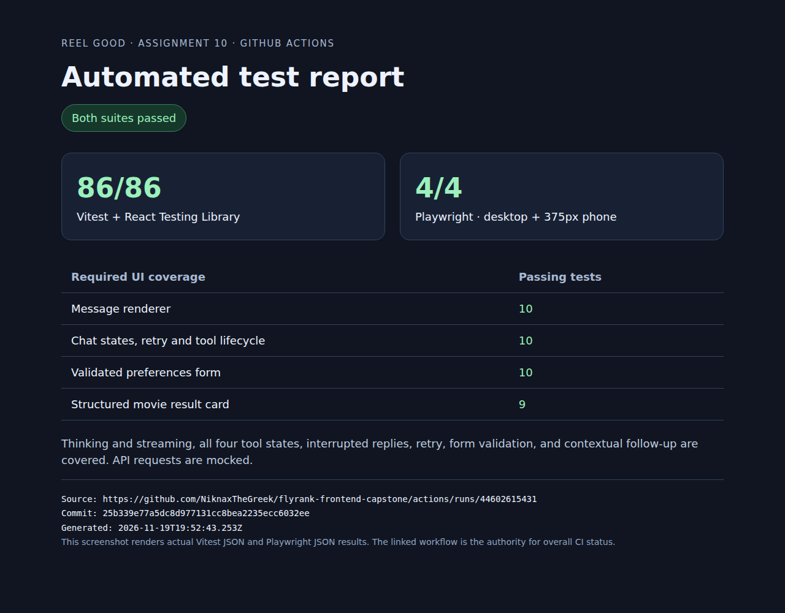

# Assignment 10 — Automated tests and CI

**Tests and CI verified; required merge-check enforcement remains pending.**

- [Passing push workflow](https://github.com/NiknaxTheGreek/flyrank-frontend-capstone/actions/runs/44602615431)
- [CI screenshot](./evidence/ci-suite.png), [machine results](./evidence/ci-verified-results.json),
  and [actual CI transcript](./evidence/ci-run.txt)
- [Draft review of the A10 changes](https://github.com/NiknaxTheGreek/flyrank-frontend-capstone/pull/4)

Reel Good's highest-risk UI is tested with Vitest, React Testing Library, and
Playwright. This branch continues `fe09-button-lifecycle`; the current application
uses React, TypeScript and Vite with same-origin server handlers.

## Scope and commands

```sh
npm ci
npm run typecheck
npm run test:ci
npm run build
npm run test:e2e:install
npm run test:e2e
```

Use Node.js 24 as specified in `.nvmrc`. `npm test` runs the same Vitest tests
without writing CI reports. `npm run verify` runs type checks, Vitest, the
production build, and Playwright; install Chromium first.

No credentials are needed. Do not add an AI key to the workflow.

## Coverage

| Area | File | Meaningful checks |
| --- | --- | --- |
| Typed message renderer | `src/components/MovieMessage.test.tsx` | User/assistant text, thinking, accumulated streamed text, each tool state, multiple results, stopped/interrupted responses: 10 tests. |
| Chat integration | `src/components/MovieChat.test.tsx` | Stop and continue, conversation history, mid-stream failure/retry, network/429/malformed data, missing completion, and a slow response: 7 tests. |
| Chat/tool integration | `src/components/MovieChat.lifecycle.test.tsx` | Whitespace validation, a controlled SSE stream through all successful tool states, failed-tool retry without duplicating messages: 3 tests. |
| Validated form | `src/components/NotificationSettings.test.tsx` | Invalid/empty email, focus and error association, trimmed valid save, opt-out, persistence, invalid stored data, storage failure and edited feedback: 10 tests. |
| Tool result card | `src/components/MovieToolCard.test.tsx` | All four states, semantic facts/IMDb link, null/zero ratings, missing data, incomplete input and interrupted loading: 9 tests. |
| Primary browser flow | `e2e/movie-picker.spec.ts` | Prompt → thinking → tool lifecycle → card → contextual follow-up; interrupted response → retry → recovery. Each runs at 1280px and 375px: 4 executions. |

The existing account/favorites, browsing, routing, movie service, error boundary,
button and motion-lab tests remain in the suite. The full Vitest total is 86.
The primary A10 tests query roles, accessible names, labels and visible content;
they do not assert CSS class names or snapshots of markup.

`MovieMessageData` is typed, and the renderer and tool fixtures use the
discriminated `MovieToolPart` union. Test source is type-checked too. Old
Testing Library `getByRole` calls had an unsupported `exact` option; removing it
retains the default exact accessible-name matching and allows test compilation.

## No real AI requests

- `src/test/setup.ts` replaces `fetch` with a rejecting mock before each test and
  fails on unmocked usage. Chat tests supply real `Response` and
  `ReadableStream` fixtures at the `/api/movie-chat` boundary, exercising the
  production SSE reader and React state handling.
- Server handler tests inject a mocked upstream fetcher.
- Playwright intercepts `/api/movie-chat` and returns deterministic SSE frames.
  It blocks third-party browser traffic, disables service workers, and starts
  the production build with empty AI/OMDb key values.
- The browser flow deliberately holds the initial response until the thinking
  indicator and enabled Stop button have been observed. It verifies the real
  request history on a follow-up, not just the final text.
- The primary browser test installs Playwright's controlled clock, pauses it
  before releasing the response, and advances each 350ms tool phase explicitly.
  This retains the lifecycle assertions without relying on the runner sampling
  short-lived UI states quickly enough. Later verification caught and corrected
  this timing issue in the initial browser test.

## AI caught and fixed a failing test

ChatGPT extracted the existing inline message rendering into `MovieMessage`
and added a regression test for a message containing two tool results. The
existing implementation rendered only `parts[1]`, although the type allowed
several tool parts. The test failed because the second film's heading,
`Arrival (2016)`, was absent. The other nine renderer tests passed.

ChatGPT ran the test, read its failure, and changed the renderer to destructure
the text part and map every remaining tool part using `toolCallId` as its key.
The second movie now renders, without changing the single-lookup server contract.
ChatGPT reran the entire suite: 86/86 passed.

- [Actual failing test output](./evidence/renderer-before-fix.txt)
- [Full passing Vitest output after the fix](./evidence/vitest-after-fix.txt)

The requirement and assertion were retained. The implementation was corrected.

## CI and merge checks

`.github/workflows/tests.yml` runs on pushes, pull requests and manual dispatch:

1. Install the committed lockfile, type-check app/test source, run Vitest.
2. Build the app and run Playwright desktop and phone journeys.
3. Report the single `A10 merge gate` job as passing only when type checks,
   both suites, the build and evidence capture succeeded.

The GitHub Actions runner captures `test-results/ci-suite.png` directly from the
actual Vitest and Playwright JSON reports after both suites pass. This is a
labelled test report, not a reconstruction of GitHub's interface. It includes
the real run URL and commit. The image is emitted in bounded workflow-log chunks
and copied into this folder as final submission evidence. It does not depend
on artifact retention or artifact storage quota.

The first CI attempt passed all 86 tests and then failed while uploading reports
because this account's Actions artifact quota was full. The workflow now runs
all verification in one job and captures evidence through its logs. Test
failures still fail the job normally; no test step uses `continue-on-error`.

**Merge protection is a separate repository setting.** Require `A10 merge gate`
for the target branch in GitHub's branch protection/ruleset settings to prevent
merging when it fails. Merely creating the workflow does not enforce that rule.
This connection has no administration-write operation and the browser is signed
out; enforcement is not yet confirmed. Private-repository protection also
depends on the GitHub account plan. The repository visibility is unchanged.

## Verification status

- Local baseline: 64 tests passed before A10.
- Local result after A10: 86 Vitest tests passed; application and test TypeScript passed;
  production build passed.
- Local Chromium could not start because this execution environment denies a
  required browser socket. Browser verification therefore runs in GitHub Actions.
- GitHub Actions push run `44602615431`: successful on commit
  `25b339e77a5dc8d977131cc8bea2235ecc6032ee`. Application/test type checks,
  86 Vitest tests, production build, and all 4 Playwright executions passed.
  No browser test was skipped, flaky, or unexpectedly failed.
- The screenshot was generated by Playwright in that GitHub Actions runner
  from its actual test JSON reports, then committed without image editing.
- Required merge protection is not enabled through this connection. For draft
  PR #4, the target is `fe09-button-lifecycle`: make `A10 merge gate` a required
  status check on that branch. See [GitHub branch settings](https://github.com/NiknaxTheGreek/flyrank-frontend-capstone/settings/branches).


