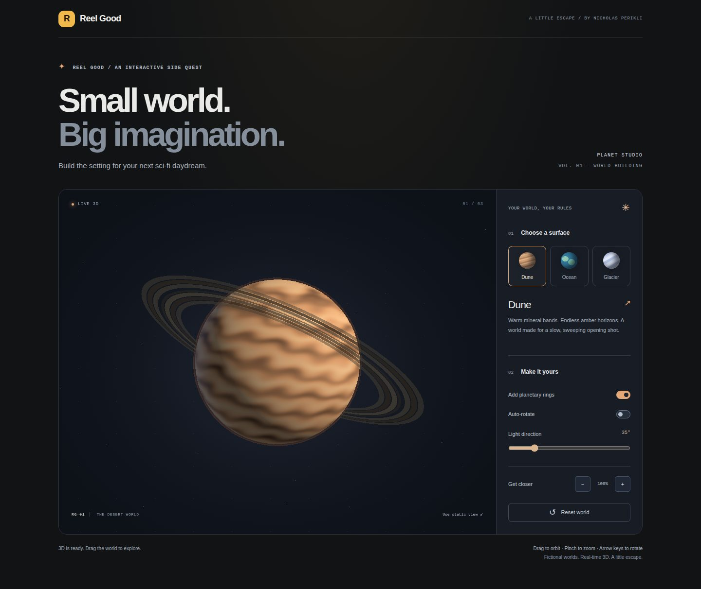

# Assignment 11 — Planet Studio

In this assignment, Reel Good gains an interactive fictional world configurator using Three.js. The experience explores real 3D geometry, responsive controls, optional loading and accessible static fallbacks while respecting rendering budgets.

Planet studio is an interactive world-building side quest inside Reel Good. Shape a fictional sci-fi setting: choose Dune, Ocean or Glacier, add or remove rings, move the sun, rotate the planet and adjust the camera. It uses React, TypeScript and raw Three.js at `/planet-studio`.

**Public demo:** https://reel-good-planet-studio.vercel.app/planet-studio — no sign-in or expiring share token. Choose **Launch 3D** to enter the real scene.


## Run

Use Node 24 and npm. No API key or sign-in is required for Planet studio.

```bash
npm ci
npm run dev
# Open http://localhost:5173/planet-studio
npm test
npm run build
npx playwright install --with-deps chromium
npm run test:3d
```

To repeat the performance capture, serve the production build with `npm run preview -- --host 127.0.0.1`, then run `npm run perf:3d` in another terminal. Optional `PLAYWRIGHT_CHROMIUM_EXECUTABLE_PATH` selects an already-installed Chromium binary; `BASE_URL` selects another deployed/served origin.

## Interaction and access

- The first view is an SVG illustration. Surface choice, rings and zoom work before 3D loads.
- Choose **Launch 3D** to download and mount the real WebGL scene. A planet mesh, seven ring bands, rim atmosphere, star points and directional lighting are created in code.
- Radio choices change the mesh texture and surface roughness. Rings change scene geometry visibility; the lighting slider moves the directional light.
- Drag with a mouse or one finger; pinch with two fingers. Wheel scrolling remains available for the page (Ctrl+wheel zooms the planet).
- All configuration uses labelled native controls. On the canvas, arrow keys rotate, `+`/`-` zoom and Home resets the camera. Visible focus is provided.
- **Use static view** unmounts the renderer and releases its resources. Context loss or an unavailable WebGL context restores the illustration, retains configuration and offers retry.
- Reduced-motion, Save-Data and low-core-count devices start with an explanation and the static illustration. All devices start without autoplay; 3D and rotation require separate explicit choices. A later reduced-motion preference change stops rotation and returns to static.

The scenes are artistic fictional worlds, not scientific planet simulations. The static illustration approximates the 3D view.

## Performance review (FE-10 lens)

The optional `PlanetCanvas` chunk is about **532 KB minified / 134 KB gzipped**. The public standalone entry is about **50 KB gzip**, including React and the UI. **No external model or texture files are downloaded:** surfaces are seamless 512×256 textures generated only when needed, cached for at most three worlds. No DRACO decoder is needed because there is no imported model.

Budgets: scene chunk ≤150 KB gzip; zero scene downloads before opt-in; DPR ≤1 on phone widths and ≤1.5 on desktop; ≤30 rendered animation frames/second; zero continuous redraws while idle, offscreen or hidden. Use no postprocessing or realtime shadow maps. Dispose geometry, textures, materials and renderer on unmount.

The inherited application entry chunk is about **167.53 KB gzip** (including existing features such as Firebase). It remains a separate optimization opportunity. Vite's 500 KB uncompressed chunk warning is retained and documented; lazy loading defers the cost rather than removing it.

Verification: **70 Vitest tests passed**, including six new behavioural tests; the TypeScript/production build passed. **Eight browser checks passed**: four against the built capstone and four against public production, across desktop and phone profiles. These cover context-loss recovery, keyboard selection and reduced motion. Browser verification ran in GitHub Actions. CI measures and captures the page, and final evidence is committed here instead of relying on temporary artifact downloads. See [PERFORMANCE.md](PERFORMANCE.md), `performance.json` and `submission.md`.

The public release uses `src/planet-standalone.tsx`, `planet.html`, `vite.planet.config.ts` and `deploy/planet-vercel.json`. Build it with `npm run build:planet`. It is an isolated static deployment with no AI routes, authentication, Firebase initialization or environment credentials. The integrated capstone route remains available in this branch. The public URL was verified anonymously; the cloud browser's unavailable WebGL context also demonstrated the designed fallback.

Measurements from a CI software renderer or emulated phone are not physical-phone thermal or battery results. A physical Android/iOS device check is a useful follow-up.

## Files and design decisions

- `src/pages/PlanetStudioPage.tsx`: UI, loading/error lifecycle and device preferences.
- `src/features/planet-studio/PlanetCanvas.tsx`: optional Three.js engine, procedural textures, render scheduler, pointer/keyboard interaction and cleanup.
- `src/features/planet-studio/StaticPlanet.tsx`: accessible inline SVG fallback.
- `src/features/planet-studio/worlds.ts`: typed settings and palettes.
- `src/pages/PlanetStudioPage.test.tsx`: six role/label-based behavioural tests; the WebGL component is mocked in unit tests.
- `e2e/planet-studio.spec.ts`: actual WebGL lifecycle, material/geometry changes, camera, context-loss recovery, keyboard radios and reduced-motion checks.
- `scripts/measure-planet.mjs`: bundle sizes, load-to-first-scene time, frame counts, idle/visibility checks, touch gestures and screenshots.

Raw Three.js keeps the existing React 18 stack intact and makes resource disposal and on-demand rendering explicit. The app route and canvas are separate lazy boundaries. A fixed-size stage prevents layout movement when the canvas appears. The renderer targets low power and caps resolution rather than using device DPR without bounds.



AI assistance: ChatGPT was used for design exploration, implementation support, testing and deployment verification.

## With more time

Add shareable world settings in the URL, a saved-world gallery, a more accurate static snapshot of each configuration, and adaptive detail based on measured frame time. Test on physical low-end Android hardware and iOS Safari. Consider splitting inherited Firebase features away from the initial app entry.

References: [Three.js documentation](https://threejs.org/docs/), [React lazy](https://react.dev/reference/react/lazy), [Playwright](https://playwright.dev/docs/intro).
