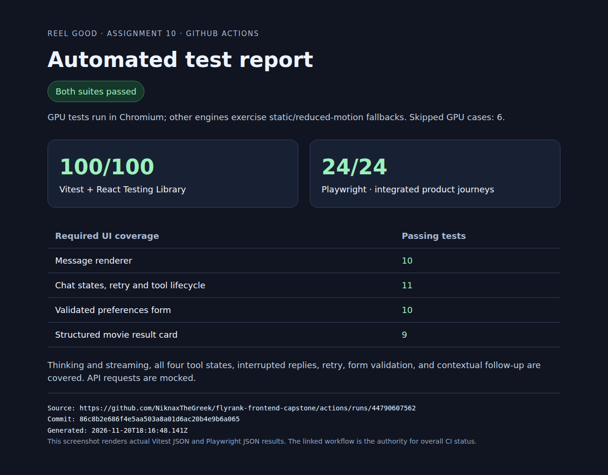
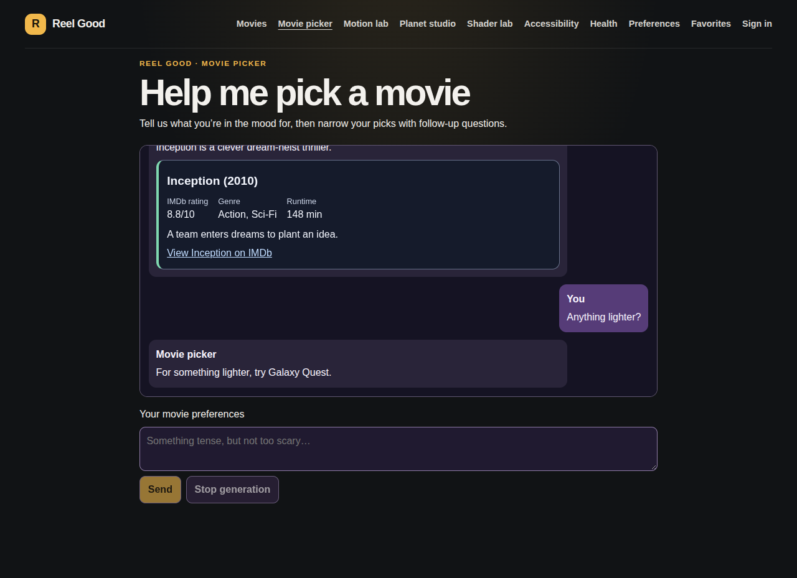
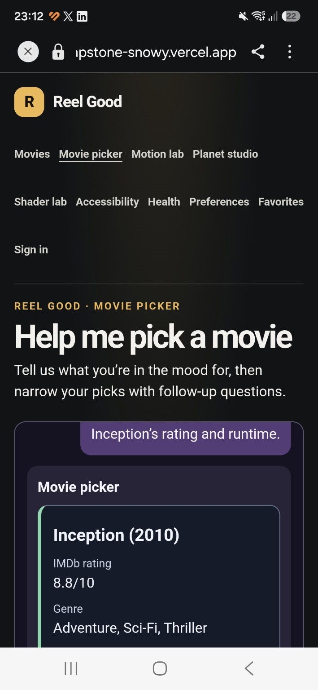
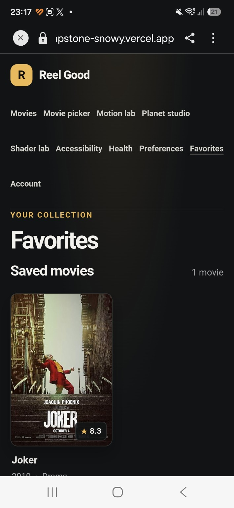

# Combined product integration — 20 November 2026

The initial A14 release omitted completed feature branches. This release combines those features without replacing newer chat safeguards or earlier assignment provenance.

## Source commits

- A11 Planet Studio: `b6d68b4a323bbf14ce2d0a6c4902ddd0d184a3b2`.
- A12 accessibility/performance: `6d46a81382a8f94e92b9e898d4c31ed35ed9422b`.
- A13 Shader Lab: `47905528da51d62bf4ecc426b675d4403b061139`.
- A5 custom controls and shadcn comparison: `ff0de2990a71a483fd0b2a12c9fbac09a868e188`.
- A14 base: `c889befe6ae8d90671799e0490df74b8eb38cb43`.

## Product changes

Shared navigation reaches `/shader-lab`, `/planet-studio`, `/playground`, `/health`, `/motion-lab` and the movie routes. The original validated A2/A10 preferences form is mounted at `/preferences`. Vercel rewrites support reloads/deep links. A5 components retain their behaviors and get scoped final-product styling; the health fetch is hosted in a bounded server function. A12 lazy loading, Firebase splitting, keyboard/focus, contrast and announcement fixes are preserved. GPU code is lazy; motion and static fallbacks remain available. Historical Next.js scaffold and workflow-comparison branches remain original exercises, not a forced framework migration.

## Verification

Local TypeScript checks and production build passed. The initial JS bundle is about 184 KB uncompressed; the ~532 KB Three.js chunk is loaded only after Launch 3D. The combined suite passed 100 tests across 20 files, including health-handler checks and a React 18 dialog-focus regression test. CI verifies the full suite and browser journeys, including new cross-lab navigation, keyboard dialogs, deep-link reload, shader rendering/pause and real 3D context-loss recovery. GPU-specific checks run in Chromium; other engines check static/reduced-motion behavior.

CI passed at commit `86c8b2e686f4e5aa503a8a01d6ac20b4e9b6a065`: 100/100 component/server tests, 24 passing browser journeys, six intentional non-Chromium GPU skips, zero unexpected failures and zero flaky tests. [Workflow](https://github.com/NiknaxTheGreek/flyrank-frontend-capstone/actions/runs/44790607562). Production deployment `dpl_3hpwnrctEscMCNfBWN8HE2fjeNdD` is READY on the same source commit; remote build took about 32 seconds. All six integrated routes and the health API returned HTTP 200. A real Inception tool call completed successfully. A production error/fatal log scan returned no matching entries at the time checked. Original A12 audit results apply to the audited commit and routes, not automatically to this combined release.

## Screenshot replacement

`evidence/production-chrome-address-bar-2026-11-20.png` is the earlier, pre-integration product. Preserve it as history, and use the replacement mobile screenshot below for the current submission pack. The requested capture was to show `/pick-a-movie`, the updated shared navigation including Shader Lab and Planet Studio, the completed Inception card and browser address bar.

[Fresh production API/route smoke results](evidence/integrated-production-smoke.json). These are distinct from browser-chrome screenshots. Earlier address-bar captures remain pre-integration history; a replacement learner mobile screenshot is now saved below.

## Replacement mobile production screenshot — 20 November 2026

Learner-provided mobile screenshot of the deployed integrated app. It shows browser chrome, the production hostname suffix, the shared navigation including Shader Lab and Planet Studio, and Inception (2010) with IMDb rating 8.8/10. The complete URL and runtime are not visible in this viewport; the fresh production API smoke independently records the runtime. This replaces the earlier screenshot as the current mobile integration evidence. It does not establish Safari or sign-in/favorites checks.

## Live Favorites-list evidence — 20 November 2026

The learner supplied this after being asked to open Favorites and refresh. The screenshot shows the Favorites navigation selected, Account instead of Sign in, Saved movies with one movie, and Joker. Together with the preceding successful-save screenshot, it closes the live signed-in save → Favorites UI walkthrough. The refresh action itself is not visible in a still image; a separate sign-out/sign-in cycle was not recorded. Real Safari remains unverified, and no Portal submission is claimed.
