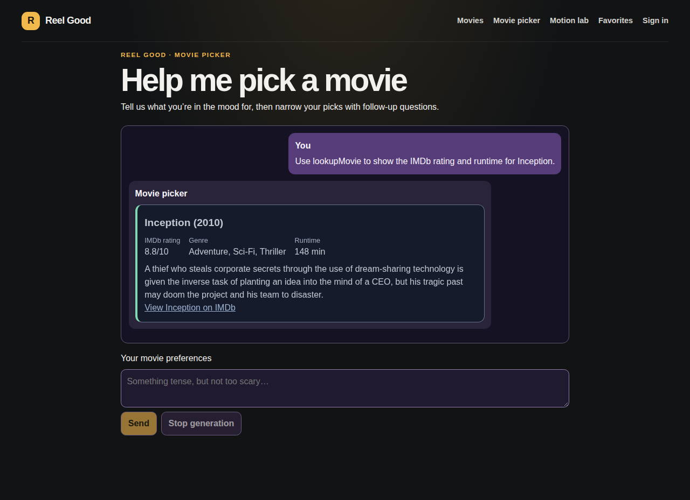
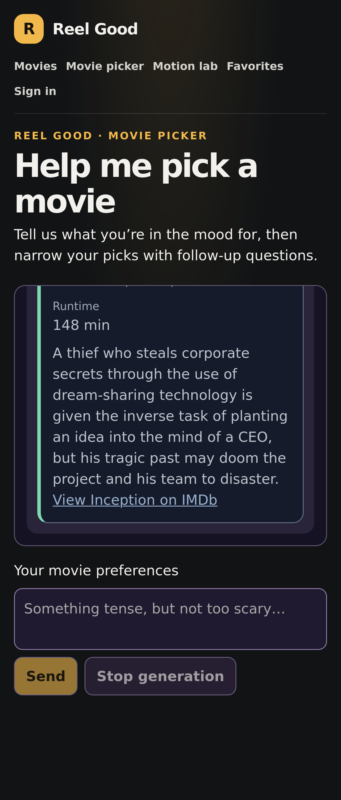
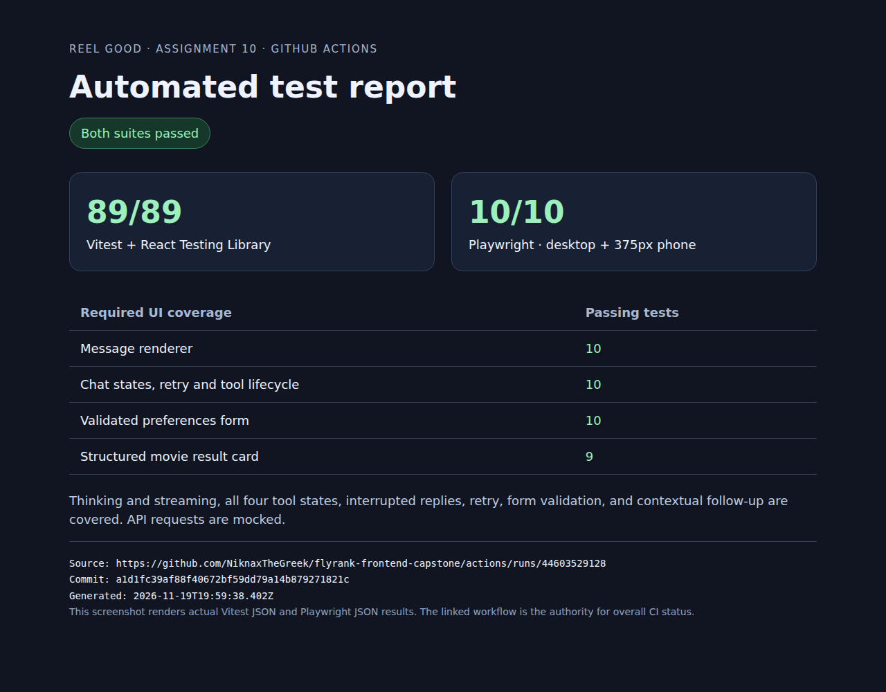
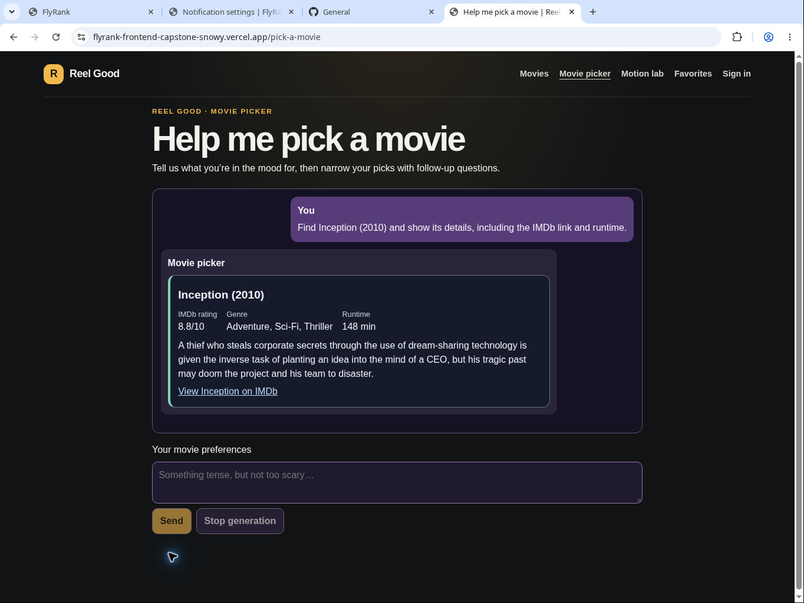
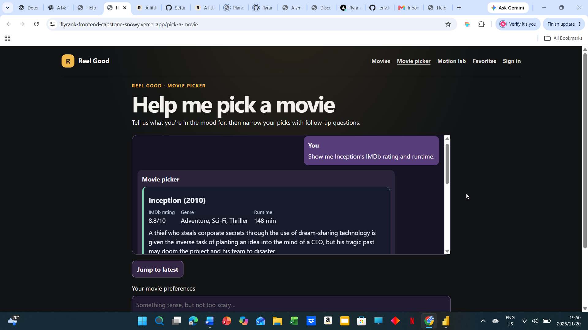

# Assignment 14 — Production release / Checkpoint 2

Production address: https://flyrank-frontend-capstone-snowy.vercel.app  
Release branch: `fe14-production-release`. The combined product now integrates A11 Planet Studio, A12 improvements, A13 Shader Lab, A5 accessibility playground and the health screen. See [integration verification](INTEGRATION.md).

## Safeguards

- 10 chat requests/minute/client IP and 1,000/hour/warm instance, bounded memory, HTTP 429 + Retry-After.
- Same-origin browser requests; POST only; 192 KB body, 20 messages, 8,000 characters/message, 32,000 total characters.
- 700 output tokens, one read-only validated movie tool, 40-second upstream deadline, 60-second Vercel maxDuration.
- Cancellation on disconnect/Stop; sanitized errors; provider secrets remain server-side.
- Rate counters are per-instance and reset on cold starts. Provider quotas or shared storage/firewall rules are required for an account-wide budget.

## Initial release checks — 19 November 2026

- Clean `npm ci` succeeded on Node 24.22.3.
- Application and test TypeScript checks passed.
- 89 Vitest tests passed across 17 files, including rate limit, origin rejection and oversized-input checks.
- Production bundle built successfully. The main JS bundle is approximately 650 KB uncompressed; Vite's size warning is a known performance follow-up.
- Local Playwright launch was blocked by the workspace's socket restrictions; no local browser pass is claimed. A release workflow runs the same mocked journey in Chromium, Firefox, desktop WebKit and iPhone-sized WebKit on GitHub Actions.
- Production OMDb and Firebase environment targets were configured; existing production Gemini credential retained. Values were not committed.

## Release results — 19 November 2026

- Production deployment `dpl_BahYrzoPYiLx815NW1EQPooJTLhG`: READY, source `d03e1ec9d7f755e474ef5e084a3da10765666728`, Node 24, Vite; remote build about 35 seconds. Later release commits add documentation/evidence/test improvements and page metadata.
- Public `/pick-a-movie` returned HTTP 200 without authentication or a share token.
- Live OMDb request returned Inception, rating 8.8, and full details.
- Live Gemini request returned all lookup lifecycle events, Inception's 148-minute runtime and verified IMDb ID, then completion.
- Foreign origin returned HTTP 403; oversized message returned HTTP 400 before model invocation.
- Live browser smoke passed in **Chromium, Firefox, desktop WebKit and iPhone-sized WebKit**, with real tool calls, no page exceptions and no horizontal overflow. [Workflow](https://github.com/NiknaxTheGreek/flyrank-frontend-capstone/actions/runs/44603529178).
- Release CI passed: **89/89 Vitest tests and 10/10 Playwright journeys**, no skips or retries/flaky results. [Workflow](https://github.com/NiknaxTheGreek/flyrank-frontend-capstone/actions/runs/44603529128), source `a1d1fc39af88f40672bf59dd79a14b879271821c`.
- Live Firebase REST check: two temporary users created; owner wrote/read a favorite; anonymous and other-user reads rejected with 401; test favorite and both users deleted successfully. [Results](evidence/firebase-smoke.json).
- Runtime error/fatal log scan for the production deployment returned no matching entries at the time checked. This is a point-in-time check, not continuous monitoring; no new log drain was configured.
- Eleven sequential invalid live requests returned 400; this slow run did not demonstrate a live 429. Deterministic tests verify the limiter's 429/Retry-After behavior. Cold starts and multiple instances remain a documented limitation.

Other screenshots: [Firefox](evidence/firefox.png), [desktop WebKit](evidence/webkit.png).

## Honest remaining checks

Real Safari and mobile Safari remain manual device checks: Linux Playwright WebKit is not the Safari app on Apple hardware. Live Firebase backend persistence/isolation passed; browser sign-in/favorite interactions are covered with mocks, not a new production UI account walkthrough. The source repository is public; no reviewer GitHub access grant is needed. The public website itself needs no login for movie search/chat. No Portal submission has been performed.

## Reviewer walkthrough

Open Movie picker, request recommendations, stop a reply, send a follow-up, request Inception's facts and inspect the movie card. Search a movie and open details. Sign in with a test account to save/remove a favorite. Repeated chat requests should eventually return a designed retryable 429. Tests use mocks and do not spend provider credits.

## Earlier production screenshot — before lab integration

[Open the live Chrome capture](evidence/production-inception-live-chrome-2026-11-20.jpg). It shows the production address bar, Inception (2010), 8.8/10, 148 minutes and IMDb link after a live lookup on 20 November 2026.

## History and AI assistance

Focused Conventional Commits preserve earlier assignment work; no shared history was rewritten. The root README records actual ChatGPT contributions, runtime provider, architecture, environment variables, local run commands and known limitations. This status file does not claim portal submission.

## Learner-captured production evidence — 20 November 2026

Pre-integration evidence (superseded for the current product): the learner supplied this Chrome screenshot showing the public production hostname in the address bar and a completed Inception lookup (8.8/10, 148 minutes). This verifies the displayed production result; it does not establish Stop behavior, Safari testing, or sign-in/favorites interactions.

## Combined product release — 20 November 2026

Shader Lab, Planet Studio, the accessibility playground, Preferences and Health are integrated into the same navigation, with A12 improvements preserved. Production deployment `dpl_3hpwnrctEscMCNfBWN8HE2fjeNdD` is READY at source `86c8b2e686f4e5aa503a8a01d6ac20b4e9b6a065`.

[Full integration verification](INTEGRATION.md) · [Actual CI report](evidence/integrated-ci-suite.png) · [Production smoke results](evidence/integrated-production-smoke.json).

All six product routes and the health API returned HTTP 200 publicly. A fresh real Inception tool call returned 8.8/10, 148 minutes and completion. The earlier address-bar captures show the pre-integration navigation; a replacement learner screenshot is still needed for the current submission pack.
