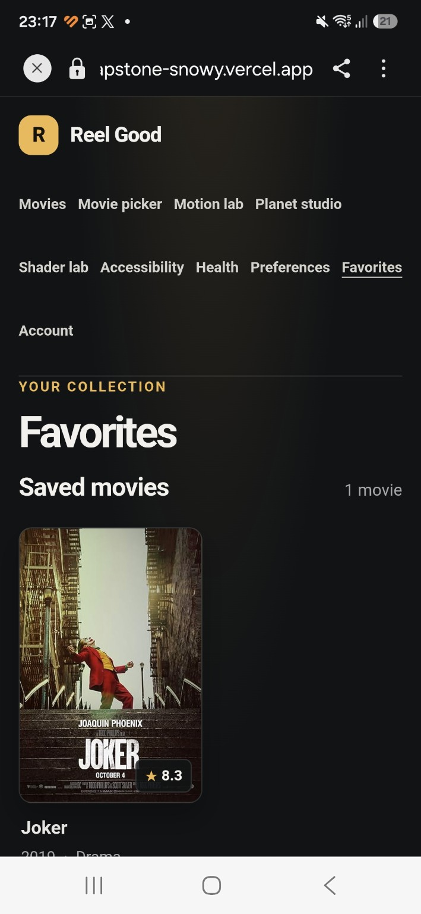

# Assignment 14 — Production release

In this assignment, the completed Reel Good experience is integrated and deployed as a production application. The release brings together movie discovery, authenticated favorites, streaming AI, structured tool results, recovery, accessibility and interactive visual labs, with documented architecture, safeguards and verification.

Production: https://flyrank-frontend-capstone-snowy.vercel.app

Final README: https://github.com/NiknaxTheGreek/flyrank-frontend-capstone/blob/fe14-production-release/README.md

Evidence and release report: https://github.com/NiknaxTheGreek/flyrank-frontend-capstone/blob/fe14-production-release/docs/assignment-14/README.md

Reel Good includes Shader Lab, Planet Studio, the accessibility playground, Motion Lab and a health screen alongside live movie search, a streaming movie assistant, validated movie lookup cards and Firebase favorites. The AI route has bounded input/output, timeouts, cancellation, origin checks and a documented per-instance limiter. Combined-release verification passed 100 component/server tests and 24 mocked browser journeys; six GPU-specific cases are skipped outside Chromium, with static fallbacks tested there. The deployed combined build passed fresh public-route, health and real Inception-tool API checks. The automated live-browser results in [live-browsers.json](evidence/live-browsers.json) record production lookups across Chromium, Firefox and desktop/mobile WebKit. The browser captures and CI report are separately labelled by evidence type. The [current production screenshot](evidence/production-inception-live-chrome-2026-11-20.jpg) shows the browser address bar and completed Inception card. Other browser screenshots and live Firebase isolation results are committed. Real Apple Safari/device testing remains unverified; the source repository is public.

Prepared for submission; not submitted to the Portal.

Current combined deployment: `86c8b2e686f4e5aa503a8a01d6ac20b4e9b6a065`. The integrated mobile screenshot below shows the updated navigation and a completed movie card.

## Integrated mobile production screenshot — 20 November 2026

[Open the integrated screenshot](evidence/production-integrated-mobile-2026-11-20.jpeg).

Learner-provided mobile screenshot of the deployed integrated app. It shows browser chrome, the production hostname suffix, the shared navigation including Shader Lab and Planet Studio, and Inception (2010) with IMDb rating 8.8/10. The complete URL and runtime are not visible in this viewport; the fresh production API smoke independently records the runtime. It does not establish Safari or sign-in/favorites checks.

## Live Favorites-list evidence — 20 November 2026

The screenshot shows the Favorites navigation selected, Account instead of Sign in, Saved movies with one movie, and Joker. Together with the preceding successful-save screenshot, it closes the live signed-in save → Favorites UI walkthrough. The refresh action itself is not visible in a still image; a separate sign-out/sign-in cycle was not recorded. Real Safari remains unverified, and no Portal submission is claimed.

## Declared device-access limitation

The learner states that they do not have access to Safari or an iPhone. Real Safari and iPhone Safari testing was therefore not performed. Automated desktop and mobile WebKit checks passed, but are not presented as real Apple-device testing. Implementation, production deployment, README and the available evidence pack are complete; Checkpoint 2 submission is pending, with this limitation disclosed. Evaluator acceptance of the limitation has not been confirmed.
## Reviewing the assignment

Explore the finished product using movie titles and preferences of your choice, try the chat and favorites flows, and inspect the integrated labs and release evidence.
